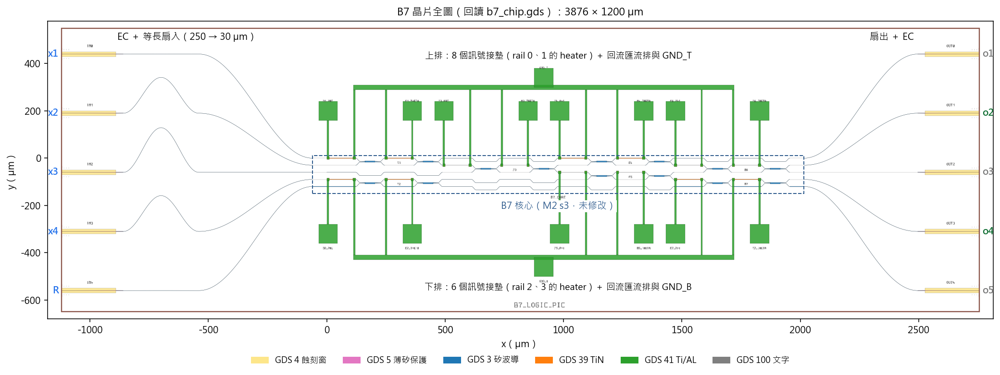
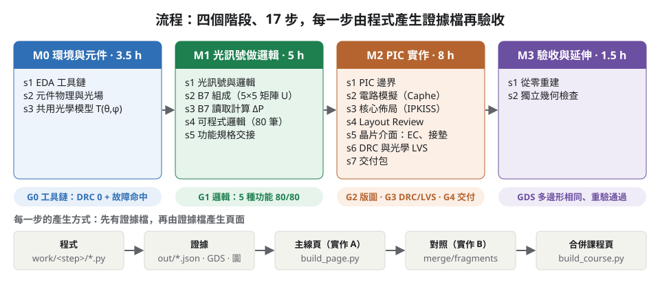
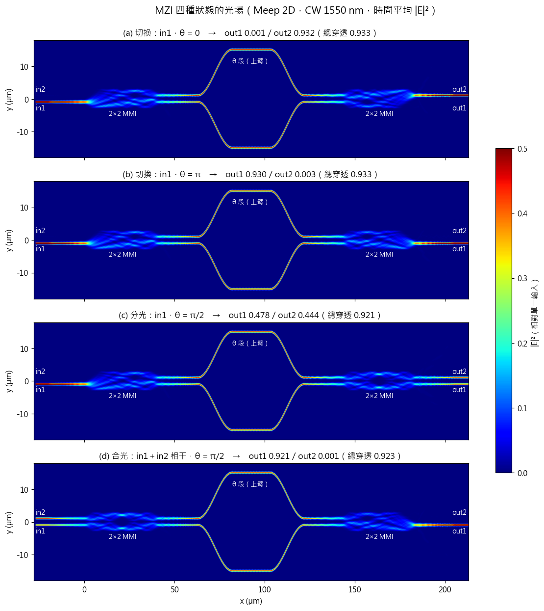
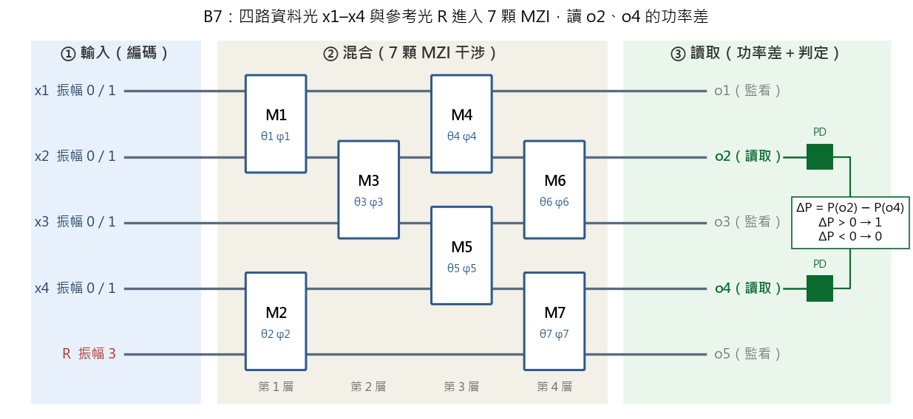
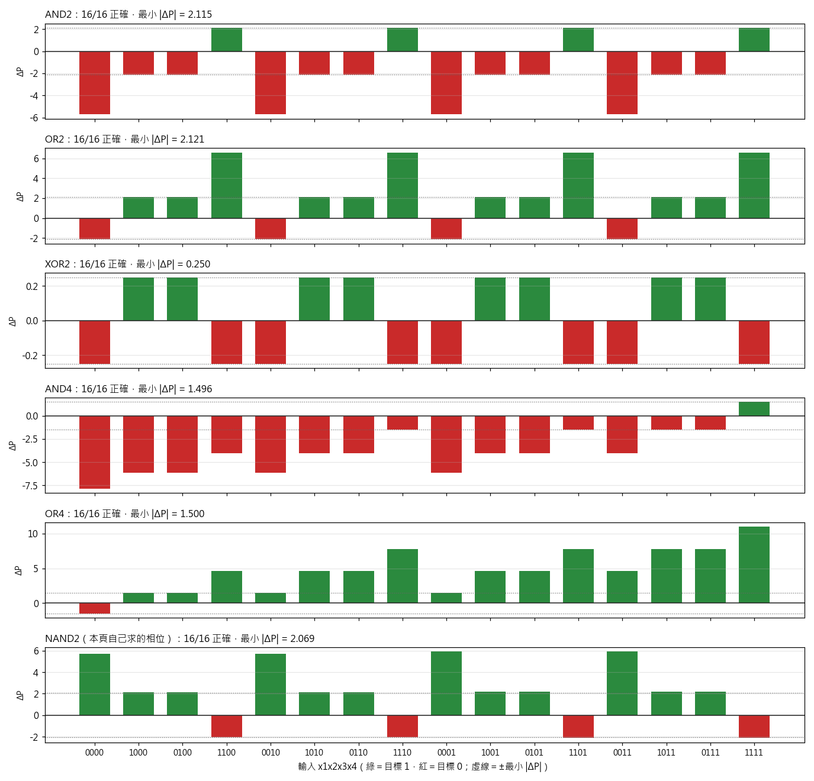
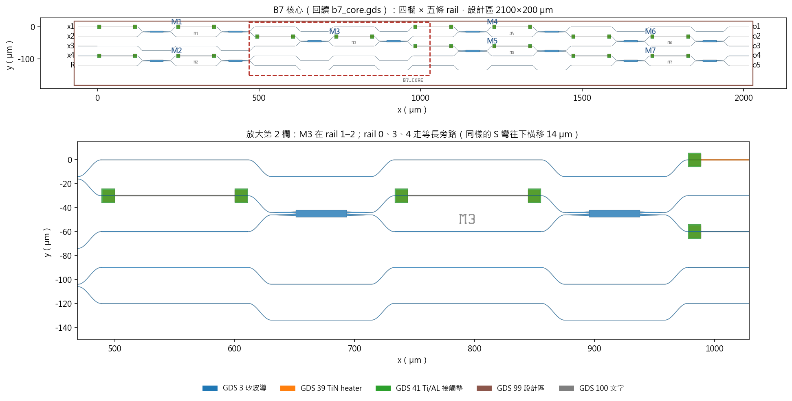
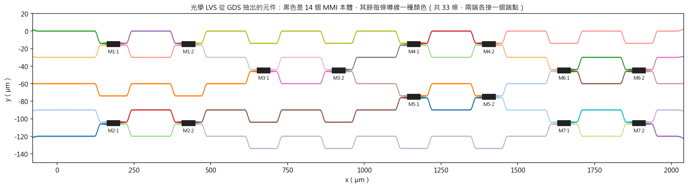

# 用光做邏輯運算的矽光子晶片：從原理到送交代工廠的設計資料包

這個專案做的事，一句話說完：**設計一顆用「光」而不是「電」來做 AND／OR／XOR 邏輯運算的矽光子晶片，並把設計、驗證到交付的每一步做成可以重做、可以檢查的課程。**

- **目的**：證明一組 7 顆光學干涉儀（MZI）組成的光路，只要調整相位，就能在同一顆晶片上切換出 5 種邏輯功能，並且這個設計可以通過製程規則檢查、被別人從零重建，交給代工廠（foundry）下線。
- **方法**：先用物理模擬看懂單顆干涉儀怎麼控制光，再用數學模型驗證整個光路的 80 筆真值表，接著用 Python 版圖工具畫出晶片、做設計規則檢查與連接檢查，最後打包成可重現的交付包。每一步都由程式產生證據檔，數字不手寫。
- **結果**：一顆 3876 × 1200 µm 的晶片版圖，5 種邏輯功能 80 筆輸入全部正確、製程規則 0 違規、在乾淨環境從零重建可得到完全相同的幾何；兩套獨立完成的實作互相印證。還**沒有**實際下線與量測。



> 這個 repo 只放程式、設定、證據檔與圖，不放產生出來的 HTML 課程頁；頁面可依[重跑方式](#重跑方式)在本機產生。

## 基本定義


| 名詞 | 全名 | 白話說明 |
|---|---|---|
| 矽光子、PIC | Photonic Integrated Circuit，光子積體電路 | 用半導體製程在矽晶片上做出讓光走的線路，就像電子晶片讓電流走一樣。 |
| 波導 | waveguide | 晶片上寬約 0.45 µm 的矽條，光被束縛在裡面傳播，相當於電路的導線。 |
| MMI | Multi-Mode Interference coupler，多模干涉耦合器 | 一個 2 進 2 出的元件，把進來的光平均分成兩半（50:50）。 |
| MZI | Mach–Zehnder Interferometer，馬赫–任德干涉儀 | 兩個 MMI 中間夾兩條臂。改變其中一條臂的相位，就能決定光從哪個出口出去、各出多少。是本設計的基本開關。 |
| 相位 θ、φ | phase | 光波的「時間差」，單位弧度。θ 控制 MZI 的分光比例，φ 對齊兩路光的相對相位。 |
| heater、加熱器 | thermo-optic phase shifter | 波導上方的一條金屬電阻。通電發熱，矽的折射率改變，光的相位跟著改變。這就是「用電調相位」的方法。 |
| B7 | 本設計的光邏輯核心代號，沿用原版教材的名稱 | 5 條平行波導、7 顆 MZI、分 4 層排列的干涉網路，共 14 個相位控制通道（每顆 MZI 一個 θ、一個 φ）。 |
| x1–x4、R | 輸入訊號 | x1–x4 是 4 路資料光，振幅 0 代表位元 0、振幅 1 代表位元 1。R 是參考光，振幅固定為 3，用來提供干涉的基準。 |
| o1–o5 | 輸出埠 | 5 個輸出口。只讀 o2 與 o4，其他 3 個只監看。 |
| ΔP | 功率差 | ΔP = P(o2) − P(o4)。ΔP > 0 判為 1，ΔP < 0 判為 0。這就是「光邏輯」的輸出。 |
| 裕量 | margin | 80 筆輸入中 \|ΔP\| 最小的那一個值。裕量越大，判讀越不容易被雜訊翻轉。 |
| 真值表、80 筆 | truth table | 4 個輸入有 16 種組合；5 種功能 × 16 = 80 筆，全部要判對。 |
| 等長、旁路 | matched bypass | 同一欄裡沒有經過 MZI 的波導，也走和 MZI 臂一樣長的路，讓各路光到達下一欄時相位一致。 |
| PDK、CORNERSTONE | Process Design Kit | 代工廠提供的「設計套件」：有哪些層、元件長什麼樣、哪些幾何不能畫。本設計用英國 CORNERSTONE 的 Si220 被動製程。 |
| IPKISS、Caphe | Luceda 的光子設計軟體 | IPKISS 用 Python 畫版圖；Caphe 是它附的電路模擬器，用來在佈局前後算整個光路的行為。 |
| GDS | GDSII 檔案格式 | 晶片版圖的標準交換格式，裡面是一層層的多邊形。交給代工廠的就是這個檔。 |
| DRC | Design Rule Check，設計規則檢查 | 檢查版圖有沒有違反製程的幾何限制（最小線寬、最小間距等）。 |
| 光學 LVS | Layout vs. Schematic，版圖對電路 | 只看 GDS，把元件和導線辨認出來，重建出連接表，再和原本的規格比對，確認「畫出來的」和「設計的」是同一個電路。 |
| EC | Edge Coupler，邊緣耦合器 | 晶片邊緣讓光纖對接的結構。本設計用薄矽尖端，10 個（5 進 5 出）。 |
| 接墊、PAD | bond pad | 讓探針或打線接上的金屬方塊，用來給加熱器通電。 |
| FDTD、Meep | 時域有限差分法；Meep 是開源的 FDTD 軟體 | 直接解馬克士威方程式，畫出光在元件裡怎麼傳播的「光場圖」。 |
| femwell | 開源的波導模態求解器 | 算波導裡光的有效折射率與模態分布。 |
| KLayout | 開源版圖檢視與 DRC 工具 | 本專案用它跑 DRC。 |
| 故障注入 | fault injection | 故意把設計弄錯（例如把一顆 MZI 翻轉），確認檢查程式真的抓得到。沒有這一步，「檢查通過」不能證明檢查有效。 |
| 證據檔 | evidence JSON | 每一步的程式把結果寫進 JSON，頁面上的每個數字都從這裡來，不手寫。 |
| M、s | module、step | 步驟代號。M2 s5 = 第 2 階段第 5 步。檔案夾也用這個命名（`m2_s5`）。 |
| 實作 A、實作 B | 兩套獨立完成的實作 | 同一份教材、兩個人各自寫程式各自跑。實作 A 是主線（`impl_a/`），實作 B 用來對照（`impl_b/`）。 |

## 目的

傳統邏輯閘用電晶體做。這個專案要回答的問題是：**能不能用一組固定的光路，只靠調整相位，就做出不同的邏輯閘？** 如果可以，同一顆晶片就能當 AND、OR 或 XOR 用，而且運算發生在光傳播的瞬間，不需要先把光轉成電。

具體目標分三層：

1. **理解**：從單顆 MZI 的物理行為出發，看懂光怎麼被切換、分光、合光，再看懂 7 顆 MZI 怎麼組成一個 5×5 的轉換矩陣。
2. **驗證**：用模型證明同一組光路換 14 個相位，就能做 AND2、OR2、XOR2、AND4、OR4，5 種功能 80 筆輸入全對；並且量化它對相位誤差、外部設備不準的容忍度。
3. **實作與交付**：把這個設計畫成符合 CORNERSTONE 製程規則的晶片版圖，接上光纖耦合口與電極，通過 DRC 與連接檢查，打包成任何人都能重建與重驗的交付包。

這同時也是一門課：每一步都要學員在自己的電腦重新執行，不接受「老師說結果是這樣」。

## 方法

整個流程分四個階段、17 步。每一步固定回答「這一步要解決什麼問題 → 怎麼做 → 檢查結果 → 什麼算通過」，結果由程式產生證據檔，再由證據檔產生頁面。



| 階段 | 要解決的問題 | 做法 | 通過條件 |
|---|---|---|---|
| **M0 環境與元件**（3 步） | 工具能不能跑？光在 MMI、MZI 裡到底怎麼走？ | 檢查工具鏈並做 DRC 故障注入；femwell 算波導模態；Meep 畫光場圖；寫出 MZI 的 2×2 矩陣模型 T(θ,φ) 並做單元測試 | 工具實際執行、正常版 DRC 0 違規且 8 種故障全部命中、模型測試全過 |
| **M1 光訊號做邏輯**（5 步） | 7 顆 MZI 怎麼組成邏輯？換相位真的能換功能嗎？ | 推導 5×5 矩陣 U（三種算法互相核對）；手算 ΔP；載入 14 個相位跑 80 筆真值表；掃描相位誤差；把規格寫成 JSON 交給下一階段 | 80/80 正確、相位誤差 σ ≤ 0.02 rad 仍全對、規格經獨立檢查 |
| **M2 晶片實作**（7 步） | 電路怎麼變成實體版圖？版圖畫出來後功能還對嗎？ | 定義晶片邊界與外部設備需求；Caphe 電路模擬；IPKISS 畫核心佈局；Layout Review；加上 EC、接墊、回流；DRC 與光學 LVS；打包交付 | 佈局後不改相位仍 80/80、DRC 0 且規則經故障注入驗證、LVS 與規格一致、交付包解壓後能重建 GDS |
| **M3 驗收與延伸**（2 步） | 別人能從零重做出同一顆晶片嗎？換個方法檢查結論一樣嗎？ | 一鍵重建全部 20 支程式並逐檔比對；用 Python／Shapely 自寫幾何檢查，與 KLayout DRC 逐項對照 | 最終 GDS 多邊形完全相同；兩種檢查結論一致 |

建議時數：M0 3.5 小時、M1 5 小時、M2 8 小時、M3 1.5 小時，Meep 光場模擬另需約 4 小時背景計算。

## 原理：用 MZI 做邏輯

### 一顆 MZI 怎麼控制光

每顆 MZI 由兩個 2×2 MMI 和中間的兩條臂組成。上臂有一條加熱器，通電改變相位 θ。下圖是用 Meep 做 2D FDTD 模擬、在 1550 nm 波長下的四種狀態：

- (a) θ = 0：光從 in1 進，全部交叉到 out2。
- (b) θ = π：光直通到 out1。
- (c) θ = π/2：光平均分到兩個出口。
- (d) 兩路光同時進、相位差 180°、θ = π/2：兩路合成一路，從 out1 出去。

(a)(b) 的消光比（想要的出口與不想要的出口功率比）為 25–29 dB，也就是漏光不到 0.3%。(d) 說明了為什麼光邏輯要先把「光場」相加再取平方算功率：只有相位對了，兩路光才會合在一起，這就是干涉。



### B7：7 顆 MZI 組成的可程式光路

把 7 顆 MZI 排成 4 層、跨接在 5 條平行波導上，就是 B7 核心。輸入端：4 路資料光 x1–x4（振幅 0 或 1）加一路參考光 R（振幅 3）。光經過 4 層干涉後，讀取 o2 與 o4 的功率差 ΔP。

為什麼需要參考光 R？因為單一顆 MZI 只能做到 14 種 2 輸入邏輯中的 7 種，剛好是「輸入 00 → 輸出 0」的那些。加入 R 之後，14 種都做得到：R 提供一個固定的干涉基準，讓「全部輸入都是 0」時 ΔP 仍能不為 0。

整個光路在數學上是一個 5×5 的複數矩陣 U，輸出光場 y = U·v。本專案用三種算法（矩陣相乘、逐層追蹤、路徑展開）各自算出 U 並互相核對。



### 換 14 個相位就換功能

同一組光路，只改 7 個 θ 與 7 個 φ，就能切換功能。下圖每一列是一種功能的 16 筆輸入；綠色代表目標輸出 1、紅色代表 0，長條高度是 ΔP。只要綠的在零線上方、紅的在零線下方，就是判對。

| 功能 | 正確筆數 | 最小裕量 \|ΔP\| | 說明 |
|---|---|---|---|
| AND2 | 16/16 | 2.115 | 2 輸入 AND |
| OR2 | 16/16 | 2.121 | 2 輸入 OR |
| XOR2 | 16/16 | 0.250 | 2 輸入 XOR，裕量最小，因為 XOR 不是線性可分，靠干涉的交叉項才做得到 |
| AND4 | 16/16 | 1.496 | 4 輸入 AND |
| OR4 | 16/16 | 1.500 | 4 輸入 OR |
| NAND2 | 16/16 | 2.069 | 不在原始 5 種之內，學員自己用最佳化求出相位，證明方法可以推廣 |

相位誤差容忍度：對 14 個相位加上標準差 σ ≤ 0.02 rad 的隨機誤差，80 筆仍全對。這個數字後來成為交給晶片實作階段的相位精度規格。



## 從電路到晶片

### 核心佈局：為什麼要「等長旁路」

用 IPKISS 把 7 顆 MZI 放成四欄、五條波導。關鍵決定是：**同一欄裡沒有經過 MZI 的波導，也要走一樣的 S 彎和直線**（圖中下半部放大的第 2 欄：M3 跨在第 1、2 條波導上，其餘 3 條走同樣形狀的旁路）。

這樣做的理由是相位。光走不同長度的路，到達下一欄時相位就不同；如果旁路是直線、比 MZI 臂短，模型算好的 14 個相位就會失效。本設計的旁路與 MZI 臂等長（510.133 µm），所以佈局後的電路**不改相位**就是 80/80，而且 1530–1570 nm 整個波段都不需要重新校正。對照組實作 B 用了直線旁路，佈局後只剩 53/80 正確，重新校正後也只剩 ±3 nm 的可用波段。這是兩套實作最大的差異。

核心尺寸 2076 × 177 µm，DRC 0 違規。故障注入確認了 5 種佈局錯誤（例如 MZI 翻轉、放錯波導、位移 0.1 µm）分別會被 DRC、連接表抽取或等長檢查抓到。



### 晶片介面：光纖怎麼接、電怎麼進

把核心原樣放進 3876 × 1200 µm 的晶片。左右各 5 個薄矽尖端 EC 讓光纖對接；輸入側 5 條扇入波導也做到等長（長度差 2×10⁻⁵ µm），否則 4 路資料光到達核心時相位不一致（故障注入顯示扇入不等長會造成 27/80 錯）。上下兩排共 14 個訊號接墊對應 14 個加熱器，加 2 個回流（接地）匯流排，單層金屬「訊號在內、回流在外」，經檢查無短路、無開路。

### 簽核：只讀 GDS 的光學 LVS

交付前的最後一道檢查，刻意**不看產生版圖的程式**，只讀 GDS 檔：從多邊形裡辨認出 14 個 MMI 本體與 33 條導線（下圖每條一種顏色），重建連接表，再和 M1 交下來的規格比對。同時確認 14 個加熱器各自接到正確的接墊。這一步獨立於畫圖的程式，所以能抓到「程式邏輯對但畫出來不對」的錯。

DRC 方面：CORNERSTONE 的 30 條規則全部通過；其中設計實際用到的 12 條，各自用故障注入確認會觸發。



## 結果

### 主要數字

| 項目 | 結果 | 這代表什麼 |
|---|---|---|
| 邏輯功能 | 5 種功能、80 筆輸入全部正確 | 同一光路換相位就換功能的構想成立 |
| 最小裕量 | XOR2 0.25；其餘 1.5–2.1 | XOR 最脆弱，是外部設備精度要求的來源 |
| 相位精度需求 | σ ≤ 0.02 rad 全對 | 加熱器校正要做到這個精度 |
| 外部設備容忍度 | 兩個光偵測器不平衡 −21%～+31%、R 振幅 ±13%、R 相位 −33°～+42°、消光比 ≥ 18.3 dB | 晶片外的雷射、調變器、偵測器要做到多準 |
| 佈局後功能 | 不改相位 80/80，1530–1570 nm 皆通過 | 等長旁路與等長扇入的設計有效 |
| 核心 | 2076 × 177 µm，DRC 0 | — |
| 晶片 | 3876 × 1200 µm，10 個 EC，14 + 2 個電氣網路，DRC 0 | 可送件的完整版圖 |
| 光學 LVS | 14 個 MMI、33 條導線，與規格一致 | 畫出來的和設計的是同一個電路 |
| 交付包 | 53 個檔案；解壓後只用包內程式重建出相同的 969 個多邊形；竄改 1 位元組會被抓到 | 任何人拿到包都能重驗 |
| 從零重建 | 20 支程式約 7 分鐘；126 個產出檔 70 個位元相同、56 個內容等價、0 個不同 | 整條流程可重現 |
| 獨立幾何檢查 | 自寫 Shapely 檢查與 KLayout DRC 逐項一致；最小線寬 0.350 µm、最小間距 0.53 µm | 不依賴單一工具的結論 |
| 元件模擬 | 波導 TE0 有效折射率 2.3532、單模上限 0.45 µm；PDK MMI 分光 0.488／0.487 | 元件行為與 PDK 宣稱一致 |

### 兩套獨立實作互相印證

同一份教材由兩個人各自完成，不共用數字。前半段（M0 到 M2 s2）兩套的模型、約定與 80 筆真值表完全一致，等於多了一次獨立驗證。後半段（M2 s3 起）兩套做出**不同的佈局**：

| 項目 | 實作 A（主線） | 實作 B（對照） |
|---|---|---|
| 旁路 | 與 MZI 臂等長 | 直線，短 21.13 µm |
| 佈局後功能 | 不改相位 80/80，1530–1570 nm | 原相位 53/80，重校正後僅 ±3 nm |
| 扇入 | 等長（差 2×10⁻⁵ µm） | 長度差 167.861 µm |
| 晶片尺寸 | 3876 × 1200 µm | 3860 × 1640 µm |
| S 彎最小半徑 | 5.23 µm | 7.67 µm（更保守） |
| 每步 DRC | 有 | M2 s3 沒有 |

主線採用實作 A，因為功能在佈局後不需重校正、每一步都有 DRC 與抽出的電路、交付包能重建 GDS。實作 B 的長處（更大的彎道半徑、竄改測試、Virtuoso 與 Calibre 的 GUI 操作、真實 DRC 違規的修正過程）都寫進各頁的「對照」一節。

### 還沒做到的事

- **沒有實體驗證**：沒有下線、封裝與量測。所有結果都是模擬與版圖檢查。
- **模型是理想的**：PDK 的電路模型把 MMI 當成無損 50:50；FDTD 量到的實際分光 0.488／0.487 與損耗沒有進電路模擬。
- **彎道損耗未知**：主線 S 彎最小半徑 5.23 µm 通過 DRC，但兩套都沒有模擬或量測彎道損耗；實作 B 認為應拉大到 7.5 µm 以上。
- **實作 B 的 53/80 原因未定**：可能來自直線旁路的真實長度差，也可能是線長回註模型沒有計入 MMI 本體長度。
- **沒有 Calibre LVS**：Virtuoso 沒有 CORNERSTONE 的製程套件，只做了 DRC 交叉比對。

## 為什麼這些檢查可信

這個專案花很多力氣在「證明檢查有效」，而不只是「檢查通過」：

| 做法 | 為什麼需要 |
|---|---|
| 每個檢查都配故障注入 | DRC 0 違規可能是規則沒載入；單元測試全過可能是測試太鬆。故意弄錯一次，確認抓得到，檢查才算數。 |
| 檢查程式獨立於產生程式 | 光學 LVS 只讀 GDS；規格檢查不經同一份程式。這樣才能抓到「程式邏輯對但輸出不對」。 |
| 換一種工具重做 | M3 用 Python／Shapely 自寫幾何檢查，與 KLayout 逐項對照；M2 s7 用 Virtuoso／Calibre 交叉比對。 |
| 從零重建 | 在乾淨資料夾依序重跑全部程式，逐檔比對產出。 |
| 跨步驟的檔案以 SHA-256 綁定 | 相位檔、規格、沿用的光場資料都記雜湊；上游改了下游會停下。 |
| 兩套獨立實作 | 前半段數字一致，後半段差異可解釋。 |

## 工具鏈

| 工具 | 版本 | 用途 |
|---|---|---|
| Luceda IPKISS 3 | 2026.03.3 | 用 Python 畫版圖、Caphe 電路模擬、從版圖抽連接表 |
| CORNERSTONE PDK | 2.6（luceda1） | Si220 被動製程的元件、層定義與 DRC 規則 |
| femwell | 0.1.12 | 波導模態 |
| Meep | 1.35.0（WSL Ubuntu） | 2D FDTD 光場圖 |
| KLayout | 0.30.12 | DRC、GDS 檢視 |
| Cadence Virtuoso／Siemens Calibre | — | 批次匯入匯出與 DRC 交叉比對（選用） |
| Python | NumPy、SciPy、Shapely、Matplotlib | 模型、獨立幾何檢查、繪圖 |

工具路徑統一由 [`impl_a/EDA_paths.json`](impl_a/EDA_paths.json) 讀取。IPKISS 與 CORNERSTONE PDK 需自行取得授權，本 repo 不含這兩者。

## 目錄結構

| 路徑 | 內容 |
|---|---|
| `docs/img/` | 本說明用的圖 |
| `course/figures/`、`course/figures_b/` | 課程頁用的圖（主線、實作 B）；`course.css` |
| `impl_a/` | 實作 A（主線）的程式與證據：`EDA_paths.json`、`env/`、`sources/`、`spec/`、`work/<步驟>/out/` |
| `impl_a/work/common/` | 共用模型：`mzi.py`（T(θ,φ)）、`b7.py`（5×5 矩陣）、`b7_layout.py`（IPKISS 佈局）、`b7_circuit.py`（Caphe 電路）、DRC 規則檔 |
| `impl_a/spec/` | M1 交給 M2 的規格：`pic_spec.json`（光路、埠位、相位通道、判讀規則）、`truth_table.json`（80 筆） |
| `impl_b/` | 實作 B 的程式與證據：`scripts/`、`work/`、`config/`、`evidence/`、`learner/`、`delivery/` |
| `merge/` | 合併工具與各頁「對照」段落（`fragments/`） |
| `AGENT.md` | 工作規則 |

### 本 repo 未收錄的內容

| 內容 | 原因 | 如何取得 |
|---|---|---|
| `impl_b/tools/KLayout/` | 可攜版執行檔 684 MB | 自行安裝 KLayout 0.30.x |
| `*.npz`（Meep 光場原始資料） | 每檔 3–19 MB | `impl_a/work/m0_s2/run_fields.sh` 重算（約 4 小時／案例）；圖已存成 PNG |
| 原版課程教材 | 非本專案原創 | — |
| `impl_b/history/`、重建副本、瀏覽器截圖 | 過程備份 | — |
| HTML 課程頁 | 由程式產生 | 依下方重跑方式在本機產生；`merge/fragments/` 是產生頁面用的原始段落，保留 |

## 重跑方式

| 實作 | 怎麼跑 |
|---|---|
| 實作 A（主線） | 在 `impl_a/` 依各步驟執行；或用 `work/m3_s1/rebuild_all.py` 一次重建（約 7 分鐘，Meep 光場以 SHA-256 沿用） |
| 實作 B | 在 `impl_b/` 執行 `scripts/run_m*_s*.ps1`（每步一支） |

重新產生課程頁（在 IPKISS 的 Python 環境）：

```
python merge/build_course.py
python merge/build_index.py
```

`impl_a/work/<步驟>/build_page.py` 會更新主線頁；更新後要再跑上面兩行，合併頁才會跟著更新。

合併工具：

- `relocate.py`：把實作 A 程式裡寫死的舊根目錄改成新位置（49 個檔案；log 與證據保留原文）。實作 B 的程式被它自己記錄的 SHA-256 釘住（835 個路徑），改一個字就會讓完整性檢查失敗，所以一律不改。
- `build_course.py`：主線頁 + `fragments/<步驟>.html` → 合併頁；自動順延節號、嵌入圖、檢查不含本機路徑。
- `build_index.py`：產生總目錄頁。

> 程式內仍有作者本機的絕對路徑。在其他電腦重跑前，先改 `impl_a/EDA_paths.json`，再用 `merge/relocate.py` 改根目錄。

## 版本歷程

| 版本 | 日期 | 重點變更 |
|---|---|---|
| v1 | 2026-10 | 實作 A：一步一頁、證據檔產生頁面、補上 M0 |
| v2 | 2026-10-31 | 實作 A／B 各自完成 M0–M3；Virtuoso／Calibre 交叉比對 |
| v3 | 2026-11-01 | 兩套實作合併成一份課程，主線 + 對照 |
| v3.1 | 2026-11-02 | 上傳 GitHub：補 README、AGENT.md、`.gitignore` |
| v3.2 | 2026-11-03 | README 加入說明圖與流程圖；HTML 頁面改為不上傳 |
| v3.3 | 2026-11-07 | README 改寫為目的、方法、結果結構，加入名詞表 |
